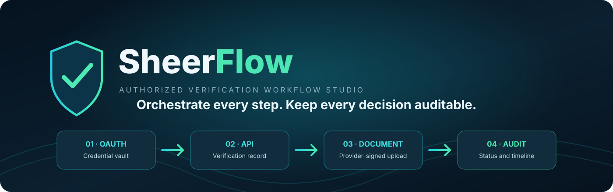
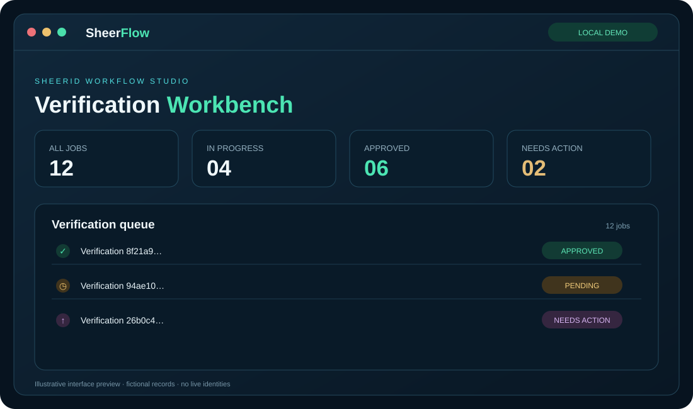

# SheerFlow — SheerID Workflow Studio

  

  **Orchestrate every step. Keep every decision auditable.**

     

SheerFlow is an independent JavaScript workbench for authorized SheerID REST API integrations. It coordinates OAuth authentication, verification creation, program-specific subject submission, organization lookup, provider-directed document uploads, status polling, recoverable input corrections, queue management and an auditable event timeline.

> **Authorization and scope:** Live mode is for organizations and developers who operate a published SheerID program and have an authorized API application. It is not a consumer discount bot, an identity generator, or a tool for making arbitrary verification links pass. Use accurate information and authentic documents with the data subject's authorization. SheerFlow is independent and is not affiliated with or endorsed by SheerID, Inc.

## Demo

[Watch the short dashboard demo](assets/demo/sheerflow-demo.mp4) · [Official SheerID developer documentation](https://developer.sheerid.com/)

## What it includes

- **OAuth 2.0 Client Credentials:** server-side token acquisition, caching and refresh. Client secrets and bearer tokens never enter browser JavaScript.
- **Verification lifecycle:** create a verification for the configured program, validate provider responses and submit the exact subject payload required by that program.
- **Organization lookup:** use the configured program theme and provider search service; do not guess organization IDs.
- **Document upload:** PDF, PNG and JPEG; up to five files per batch; signature, extension and size checks; provider-issued signed upload URLs; original file bytes are uploaded without alteration.
- **Workflow states:** approved, rejected, pending, document-required, email/SSO action-required, recoverable input errors and uncertain write outcomes.
- **Job orchestration:** bounded in-memory queue, configurable concurrency, duplicate-request protection, safe local tracking stop, provider status refresh and local history cleanup.
- **Resilience:** bounded retries for safe reads and documented transient failures, Retry-After handling and protection against blindly replaying an uncertain write.
- **Local dashboard and CLI:** job queue, workflow inspector, event timeline, upload controls, configuration diagnostics, status lookup and organization search.
- **Privacy-minded defaults:** no persistent job database; subject fields are excluded from audit events; document bytes are held in memory for upload and cleared afterward.

## Requirements

- Node.js 22.15 or newer.
- **Live mode:** a published SheerID verification program, an account with API Access permission, and an OAuth Client ID and Client Secret provisioned in MySheerID.
- **Demo mode:** Node.js only. Demo mode uses an isolated local mock client and makes no SheerID requests.

## Get your own SheerID API access

SheerFlow contains no shared API credentials. Each operator must obtain credentials from their own authorized SheerID account. The repository maintainer does not need, receive or store your credentials.

1. **Get access to a SheerID client account.** Start with the [SheerID Getting Started guide](https://developer.sheerid.com/getting-started). An existing sales contact or Product Support can help locate or establish the account.
2. **Create and publish a verification program.** In [MySheerID](https://my.sheerid.com/), create the program your organization is authorized to operate and publish it.
3. **Request the API Access role.** Ask your account administrator to assign API Access. This role is required to manage Client Applications.
4. **Create a Client Application.** In MySheerID, open **Access Management → Client Applications**, create an application and assign only the API permissions your integration requires. Record its Client ID and Client Secret. See [Obtaining OAuth credentials](https://developer.sheerid.com/tutorials/api-tokens-detail#obtaining-the-credentials).
5. **Copy your Program ID.** Open the published program in MySheerID and copy the ID for the exact program the application is authorized to operate.
6. **Enable provider Test Mode before testing.** Coordinate with your account administrator and follow SheerID's [testing guide](https://developer.sheerid.com/tutorials/testing). Use only provider-approved fictional test subjects and test documents.
7. **Configure your own machine.** Copy .env.example to .env and enter your own Client ID, Client Secret, Program ID and a unique local dashboard password. Never commit .env, paste credentials into issues or chats, or include them in screenshots.

If you are evaluating the repository and do not operate an authorized SheerID program, use local demo mode. Do not substitute consumer verification URLs, another organization's Program ID or credentials not issued to your organization.

### Credential reference

| Variable | Purpose |
|---|---|
| SHEERID_CLIENT_ID | OAuth Client Application identifier from MySheerID |
| SHEERID_CLIENT_SECRET | Secret paired with that application; keep private |
| SHEERID_PROGRAM_ID | Published program the application is authorized to operate |
| SHEERFLOW_DASHBOARD_PASSWORD | Unique local workbench password (20+ characters) |

## Quick start

~~~bash
npm ci
cp .env.example .env
# Edit .env locally with your own authorized values.
npm start
~~~

Open http://127.0.0.1:8787 and sign in with the local dashboard password. The server binds to loopback only. Do not expose the workbench directly to the internet.

For an offline walkthrough, set SHEERFLOW_MODE=demo in .env. Demo mode uses fictional examples and makes no provider requests. This is separate from SheerID's provider-side Test Mode.

## CLI

~~~bash
npm run doctor
npm run status -- YOUR_VERIFICATION_ID
npm run organizations -- "Organization name"
npm test
npm run check
npm run verify
~~~

See [API workflow notes](docs/API_WORKFLOW.md) and [architecture](docs/ARCHITECTURE.md) for details.

## Security and privacy

- Keep real credentials in .env; it is excluded by .gitignore. Only .env.example belongs in source control.
- OAuth client secrets and access tokens stay on the server.
- The dashboard is loopback-only and protected by a local password, HttpOnly session cookie, CSRF token, host/origin validation and restrictive browser security headers.
- Subject data and document bytes are handled in memory for the workflow; they are not written to a job database. Audit events do not store subject fields or document contents.
- File signature checks do not prove that a document is genuine.
- A write with an ambiguous network outcome is not automatically replayed. Reconcile provider status before attempting another action.
- Stopping a job stops local tracking; it does not cancel a verification already created at SheerID. Refresh jobs with a known provider ID, and reconcile an unknown creation outcome before retrying.
- Read [SECURITY.md](SECURITY.md) before using the application with a live program.

SheerFlow is a local operator workbench, not a multi-tenant hosted service. Do not deploy it as a public service or share one set of credentials among unrelated users.

## Development and tests

~~~bash
npm ci
npm test
npm run check
npm run verify
~~~

Automated tests use controlled fixtures and the local demo adapter; they do not submit live verifications. Live operation still requires an authorized SheerID account and program and should first be validated with provider Test Mode.

## License and attribution

Released under the [Apache License 2.0](LICENSE). See [NOTICE](NOTICE) for trademark and third-party attribution. The SheerID REST API, documentation and service marks remain the property of their respective owners and are subject to their terms.

## Contributing

Contributions and bug reports are welcome. Read [CONTRIBUTING.md](CONTRIBUTING.md). Never include real personal information, verification IDs, credentials, documents, request dumps or signed upload URLs in issues or test fixtures.
